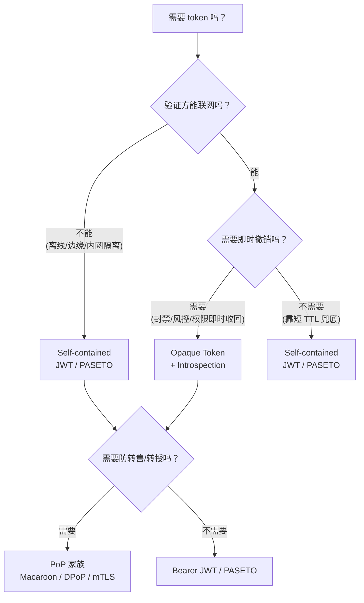

# 术语表与心智模型

> **最后更新**：2026-10-26
> **相关实验**：[`labs/01-jwt-paseto-opaque`](../labs/01-jwt-paseto-opaque)

---

## 一句话心智模型

Token 生产技术栈的所有问题，都可以归到**两个正交的问题**上：

1. **验证在哪里发生？**（本地验签 vs 远程查询）
2. **状态存在哪里？**（自包含 vs 服务端存储）

其余所有话题（撤销、轮换、多租户、性能）都是这两个问题的派生。

---

## 核心术语

### Token 形态

| 术语 | 定义 | 验证点 | 状态 |
|---|---|---|---|
| **Self-contained token** | Token 自身携带全部验证所需信息（claims + 签名） | 验证方本地验签，**无需网络** | Token 内 |
| **Opaque token** | Token 只是一个随机引用（`opaque_` 前缀），无内部结构 | 验证方**必须**查服务端 | 服务端 |
| **Reference token** | Opaque token 的别名，OAuth2 规范常用此词 | 同上 | 服务端 |
| **Bearer token** | 持有者即拥有者（"the bearer of this token"），不绑定身份 | 任何人持有即可用 | — |
| **Proof-of-possession (PoP)** | Token 需配合持有者私钥/生物特征才能使用 | 需额外绑定证明 | — |

> **PoP vs Bearer 是信任模型的分水岭。** Macaroon、SPIFFE mTLS、DPoP 都属于 PoP 家族；传统 JWT 默认是 Bearer。

### JWT 家族（RFC 7519 及其兄弟）

| 术语 | 定义 |
|---|---|
| **JWS** (RFC 7515) | JSON Web Signature —— 签名后的 token，**完整性**保障，内容 base64url 可见 |
| **JWE** (RFC 7516) | JSON Web Encryption —— 加密后的 token，**机密性**保障 |
| **JWT** (RFC 7519) | JWS 或 JWE 的容器格式（`header.payload.signature`） |
| **Claim** | Token 里的一个键值对，如 `sub`（主体）、`exp`（过期）、`aud`（受众）、`scope` |
| **Header** | JWT 的第一段，含 `alg`、`typ`、`kid` 等元信息 |
| **JWK** (RFC 7517) | JSON Web Key —— 公钥/私钥的 JSON 表示 |
| **JWKS** | JWK Set —— 多个 JWK 组成的集合，公开端点分发 |
| **kid** | Key ID —— token 里指明用哪把密钥验签，解决轮换问题 |
| **jku / x5c** | header 里指明密钥来源的字段 —— **高危**，可被攻击者利用（见 `08-attack-surface`） |
| **Registered claims** | RFC 7519 预定义的 claim：`iss` `sub` `aud` `exp` `nbf` `iat` `jti` |

### 授权相关

| 术语 | 定义 |
|---|---|
| **Scope** | 粗粒度权限字符串（`read:orders`）—— OAuth2 风格 |
| **Role / Permission** | 细粒度权限（`admin` / `order:refund`）—— 内部系统常用 |
| **audience (aud)** | token 的目标受众，防止「A 系统的 token 拿去 B 系统用」 |
| **issuer (iss)** | token 的签发方标识 |
| **introspection** (RFC 7662) | 验证方把 token 拿回签发方查询其状态 —— Opaque token 的标准解法 |
| **Token Exchange** (RFC 8693) | 用一个 token 换另一个 token（服务间令牌转换） |

### 密钥与轮换

| 术语 | 定义 |
|---|---|
| **Signing key** | 用于签发 token 的私钥 |
| **Verification key** | 用于验签的公钥 |
| **HS256 共享密钥悖论** | 对称签名意味着签发方和验证方持有**同一把**密钥 —— 验证方因此也能**伪造** token。这是 HS256 不适合跨组织场景的根本原因 |
| **Key rotation** | 定期更换密钥，旧密钥保留一段宽限期供已签发 token 验签 |
| **Key compromise / 紧急吊销** | 密钥泄露后的紧急处理 —— 只能靠缩短 TTL + 吊销列表 |
| **Envelope encryption** | 数据密钥（DEK）加密数据，主密钥（KEK）加密 DEK —— 密钥托管的标准做法 |

### 攻击面

| 术语 | 定义 |
|---|---|
| **Algorithm confusion** | 攻击者把 `alg` 从 `RS256` 改成 `HS256`，用公钥当 HMAC 密钥伪造签名 |
| **kid injection** | 攻击者控制 `kid` 指向自己的密钥文件（路径遍历 / SQL 注入 / SSRF） |
| **JWKS hijacking** | 攻击者控制 `jku` / `x5c` 让验证方从恶意地址拉公钥 |
| **Claim injection** | 未正确校验 claim 导致权限提升（如把 `role: "admin"` 塞进 payload） |
| **Token substitution** | 把某个 claim（如 `aud`）换成另一个合法 token 的值 |
| **`none` algorithm** | `alg: none` 声称无需签名 —— 成熟库都会拒绝，但自制解析器常常栽在这 |

---

## 四种形态的选型决策树

**经验规则**：
- 内部服务间、TTL 短（分钟级）、性能敏感 → **JWT**（生态成熟，工具链全）
- 跨组织、对算法混淆零容忍、要求加密 payload → **PASETO**
- 用户封禁、订阅退订、额度扣减需要即时生效 → **Opaque Token**
- 第三方代用户调用 API、需要限制二次转授 → **Macaroon / DPoP**

---

## 快速对比表

| 维度 | JWT | PASETO | Macaroon | Opaque |
|---|---|---|---|---|
| 自包含 | ✅ | ✅ | ✅ | ❌ |
| 加密 payload | 可选（JWE） | ✅ v4.local | ❌（需自己加） | N/A |
| 算法混淆风险 | ⚠️ 有（靠库防护） | ✅ 设计上消除 | ❌ 不适用 | ✅ 无算法 |
| 即时撤销 | ❌ | ❌ | ❌ | ✅ |
| 验证性能 | 快（本地验签） | 快 | 快 | 慢（需网络） |
| 生态成熟度 | 极高 | 中 | 低 | 高 |
| 委托/权限收窄 | ⚠️ 需自己设计 | ⚠️ 需自己设计 | ✅ 原生 caveat | ⚠️ 需自己设计 |
| 自实现风险 | ⚠️ 高（易踩坑） | 中 | 中 | 低 |

---

## 引用

- RFC 7519 — JSON Web Token: https://datatracker.ietf.org/doc/html/rfc7519
- RFC 7515 — JSON Web Signature: https://datatracker.ietf.org/doc/html/rfc7515
- RFC 7517 — JSON Web Key: https://datatracker.ietf.org/doc/html/rfc7517
- RFC 7662 — OAuth 2.0 Token Introspection: https://datatracker.ietf.org/doc/html/rfc7662
- RFC 8693 — OAuth 2.0 Token Exchange: https://datatracker.ietf.org/doc/html/rfc8693
- PASETO — https://github.com/paseto-standard/paseto-spec
- Macaroon — https://research.google/pubs/pub41892/
